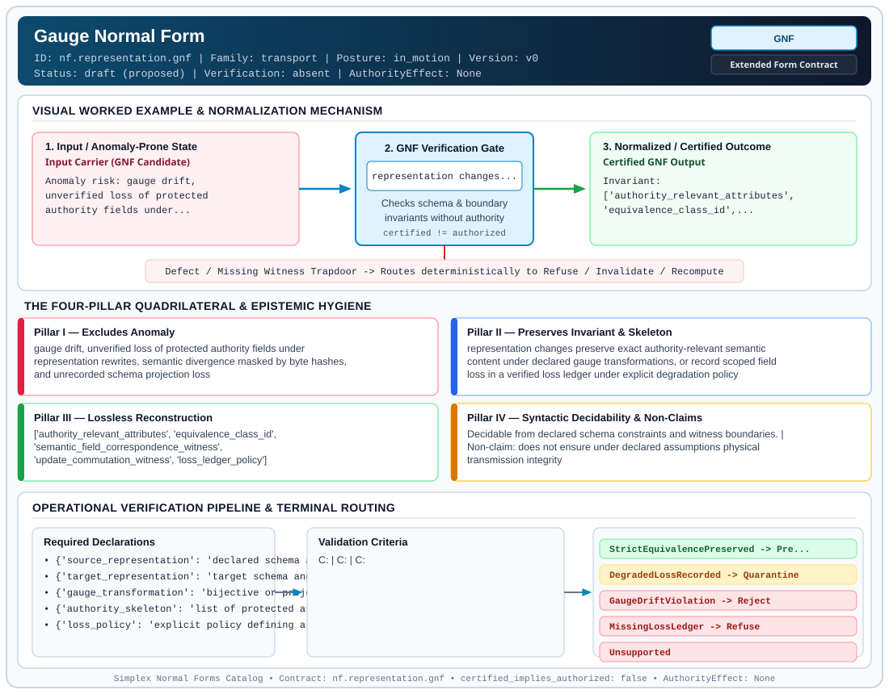

# Gauge Normal Form (`GNF`)

> **Contract ID:** `nf.representation.gnf` | **Family:** `transport` | **Index Status:** `draft` | **AuthorityEffect:** `None`

**[⬅ Back to Wiki Home](Home)** | **[View SVG Diagram](images/nf.representation.gnf.svg)**

---

## 1. Executive Summary & Metadata

Gauge Normal Form (GNF) enforces structural normalization and explicit defect routing in the transport regime.

| Property | Value |
| :--- | :--- |
| **Canonical ID** | `nf.representation.gnf` |
| **Short Name** | `GNF` |
| **Full Name** | Gauge Normal Form |
| **Family** | `transport` (Scale Ascent/Descent & Representation Transport Ledgers (`LNLF`, `LLNF`, `GNF`)) |
| **Qualification** | Extended Form Contract (Normal Form Contract) |
| **Data / Math Posture** | in_motion |
| **Index Status** | `draft` |
| **Theory Status** | `proposed` |
| **Verification Status** | `absent` |
| **Contract Version** | `v0` |
| **Governance Fence** | `AuthorityEffect: None` (`certified_implies_authorized: false`) |

---

## 2. Visual Architecture & Normalization Diagram



---

## 3. Concrete Worked Example & Mechanism

### Visual Transition Summary

| Stage | Carrier / Operator | Concrete State / Invariant |
| :--- | :--- | :--- |
| **1. Before / Candidate Input** | `Input Carrier (GNF Candidate)` | Anomaly risk: gauge drift, ; unverified loss of protected ; authority fields under... |
| **2. Normalization / Gate** | `GNF Verification Gate` | `representation changes...` (`certified_implies_authorized: false`) |
| **3. After / Certified Output** | `Certified GNF Output` | Invariant: ; ['authority_relevant_attributes', ; 'equivalence_class_id',... |

---

## 4. The Four-Pillar Quadrilateral & Non-Claims

Every contract in `simplex-normal-forms` is evaluated against the **Four-Pillar Quadrilateral** defined in `contracts/_golden_nfs/standard.yaml`:

| Pillar | Requirement | Contract Specification for `nf.representation.gnf` |
| :--- | :--- | :--- |
| **Pillar I: Excludes Anomaly** | Name and eliminate a specific class of data or state defects. | gauge drift, unverified loss of protected authority fields under representation rewrites, semantic divergence masked by byte hashes, and unrecorded schema projection loss |
| **Pillar II: Preserves Invariant** | State the structural invariant and protected skeleton preserved across transitions. | **Invariant:** representation changes preserve exact authority-relevant semantic content under declared gauge transformations, or record scoped field loss in a verified loss ledger under explicit degradation policy<br>**Protected Skeleton:** ['authority_relevant_attributes', 'equivalence_class_id', 'semantic_field_correspondence_witness', 'update_commutation_witness', 'loss_ledger_policy'] |
| **Pillar III: Lossless Reconstruction** | State the non-loss reconstruction operator (join, direct sum, pullback, or replay). | Lossless reconstruction under declared projection, direct sum, or pullback operators. |
| **Pillar IV: Syntactic Decidability** | State how conformance is decided from declared constraints without unbudgeted scans. | Decidable from declared schema and witness metadata within bounded evaluation budgets. |

### Explicit Non-Claims (`certified_implies_authorized: false`)

- does not ensure under declared assumptions physical transmission integrity
- a loss ledger solely records field loss; it does not make the original equivalence statement true. Any loss of a protected field fails strict preservation and produces only a scoped degraded outcome under declared policy
- a target hash establishes byte consistency of the output, not that its semantics match the source
- 'gauge' in this contract refers strictly to serialization, encoding, and representation equivalence across data schemas (e.g. JSON vs Protobuf vs wire tokens), not to physical gauge theory or continuous spacetime gauge symmetries

---

## 5. Operational Verification & Terminal Routing

### 5.1 Required Declarations

- **source_representation**: declared schema and data instance
- **target_representation**: target schema and encoded instance
- **gauge_transformation**: bijective or projective mapping between schemas
- **authority_skeleton**: list of protected attributes required for decision currency
- **loss_policy**: explicit policy defining allowed field drops and degradation rules

### 5.2 Required Evidence

- **semantic_correspondence_witness**: mapping source fields to target fields
- **update_commutation_witness**: proof that updates commute with gauge mapping on protected fields
- **target_validation_hash**: cryptographic digest of serialized target representation
- **loss_ledger_record**: null if strictly lossless, or explicit list of dropped fields with trigger id

### 5.3 Validation Criteria

| Criterion ID | Name | Condition |
| :--- | :--- | :--- |
| `` | **** |  |
| `` | **** |  |
| `` | **** |  |

### 5.4 Terminal Route Map

Every evaluation terminates in a declared local route mapped to a canonical terminal in `standard.yaml`:

| Local Terminal Route | Canonical Terminal |
| :--- | :--- |
| `StrictEquivalencePreserved` | `Preserve` |
| `DegradedLossRecorded` | `Quarantine` |
| `GaugeDriftViolation` | `Reject` |
| `MissingLossLedger` | `Refuse` |
| `Unsupported` | `Unsupported` |

### 5.5 Declared Failure Modes

- **symptom**: two representations (e.g. JSON and Protobuf) are claimed equivalent but differ in key currency attributes, **diagnosis**: gauge drift, **terminal**: Reject

---

## Deep-Dive Level Treatise

**AuthorityEffect:** None.  
**Level:** Level 12 (Data in Representation / Representation Shift Invariance)  
**Evidential Grade:** NATIVE IMPLEMENTED  
**Contract Reference:** [`nf.representation.gnf`](../../../../omega_engine_pfp/infrastructure/yaml/normal_forms/nf.representation.gnf.yaml)  
**Mathematical Posture:** Gauge Invariance & Fiber Bundle Projections  
**Data Posture:** In Representation  

---

## 1. Schematic & Conceptual Architecture

Gauge Normal Form (GNF) formalizes **representation freedom**:
- In modern systems, data shifts between equivalent representations: relational tables, Protobuf wire formats, JSON payloads, columnar Parquet files, or vector embeddings.
- GNF asserts that an admitted representation shift $T: \operatorname{Rep}_1 \to \operatorname{Rep}_2$ leaves all **authority-relevant observable predicates invariant**.
- Any difference between representations that cannot be distinguished by certified observers belongs to the **gauge group** $\mathcal{G}$.

```text
               Base Authority Predicates P(x)
                         ┌─────────┐
                         │ P(x)    │
                         └────┬────┘
                              │ Invariant under G
              ┌───────────────┴───────────────┐
              ▼                               ▼
     Representation A                Representation B
  (PostgreSQL JSONB Row)         (Protobuf Wire Message)
              ▲                               ▲
              └───────── Gauge Shift ─────────┘
```

---

## 2. Mathematical Invariants & Quadrilateral Properties

1. **Formal Definition:**
   Let $\mathcal{R}$ be a set of representations, and $\mathcal{O}$ a set of declared observable predicates. A transformation $g: \mathcal{R} \to \mathcal{R}$ is a **gauge transformation** if for all $O \in \mathcal{O}$ and $r \in \mathcal{R}$:
   $$O(g(r)) = O(r)$$
   A representation $r$ is in Gauge Normal Form (GNF) with respect to a canonical gauge slice $\sigma$ if:
   $$r \in \operatorname{Im}(\sigma), \quad \text{where } \sigma: \mathcal{R}/\mathcal{G} \to \mathcal{R}$$
   That is, the representation has been mapped to its unique canonical representative in the quotient fiber.

2. **The Quadrilateral Invariants:**
   - **Anomaly Excluded:** Gauge drift, semantic laundering across serialization formats, false discrepancies caused by superficial syntax variations.
   - **Protected Skeleton:** Invariant observable predicate evaluations and canonical quotient keys.
   - **Erased Structure:** Superficial syntax artifacts (key ordering, whitespace, wire framing).
   - **Reconstruction:** Functorial decode to any admitted gauge representative.

---

## 3. Terminal Routes & Verification Logic

```text
Representation Shift T: Rep1 -> Rep2
      │
      ├── All observable predicates commute (P ∘ T = P) ──► Preserve (GaugeInvariant)
      │
      ├── Erasure of non-observable syntax ───────────────► Preserve (GaugeQuotiented)
      │
      ├── Erasure of observable attribute without ledger ──► Refuse (AuthorityLaundering)
      │
      └── Transformation alters observable predicate ─────► Reject (SemanticDrift)
```

- `Preserve`: Representation shift is strictly within the declared gauge group.
- `Refuse`: Unmapped or lost attributes laundered without an explicit loss ledger.
- `Reject`: Observable truth values diverge between representations.

---

## 4. Test Evidence & Local Execution

Verified in [`test_nf_review_regressions.py`](../../../tests/normal_forms/test_nf_review_regressions.py) and [`test_tranche12_representation_and_runtime.py`](../../../tests/normal_forms/test_tranche12_representation_and_runtime.py):
- `test_gnf_json_protobuf_equivalence`: Asserts that transforming between JSON and Protobuf preserves all declared relational keys and hashes.
- `test_gnf_rejection_of_semantic_laundering`: Verifies that dropping an observable column during serialization trips immediate refusal.

---

## 5. Epistemic Claim Quadrant

1. **What it supports:**
   - Mathematical proof that data format migrations preserve semantic authority.
   - Formal identification of gauge freedom versus genuine information loss.
2. **What it does not support:**
   - canonical lossless translation between structurally incompatible data models.
3. **The narrowest defensible claim:**
   - GNF ensures under declared assumptions that two representations evaluate identically on all declared observer predicates.
4. **The next test needed:**
   - Property tests asserting that canonical JSON serialization (RFC 8785) is an exact gauge slice for arbitrary JSON objects.

---

## 6. Epistemic Claim Hygiene Quadrant

In accordance with the repository's epistemic claim discipline:

1. **What it supports:**
   - Supports syntactic and operational checking of `nf.representation.gnf` (`GNF`) against its declared schema, boundary constraints, and witness obligations in this model.
   - Supports deterministic terminal routing (`StrictEquivalencePreserved, DegradedLossRecorded, GaugeDriftViolation, MissingLossLedger`) when required declarations or invariants fail.
2. **What it does not support:**
   - Does not confer operational authority (`AuthorityEffect: None`, `certified_implies_authorized: false`).
   - Does not claim semantic truth of undeclared external processes or unverified upstream inputs beyond the declaredprotected skeleton.
3. **The narrowest defensible claim:**
   - Within the declared substrate `in_motion`, this contract enforces that `gauge drift, unverified loss of protected authority fields under representation rewrites, semantic divergence masked by byte hashes, and unrecorded schema projection loss` is either excluded under `representation changes preserve exact authority-relevant semantic content under declared gauge transformations, or record scoped field loss in a verified loss ledger under explicit degradation policy` or routed to an explicit refusal/recovery terminal.
4. **The next test needed:**
   - Property-based falsification and mutation testing across boundary edge cases and composed multi-step pipelines for `nf.representation.gnf`.

---

## 7. Canonical YAML Contract (`contracts/nf.representation.gnf.yaml`)

<details>
<summary><strong>Click to expand full canonical YAML contract (contracts/nf.representation.gnf.yaml)</strong></summary>

```yaml
schema_version: smplx.nf.contract.v0
contract_kind: normal_form_contract
identity:
  id: nf.representation.gnf
  name: Gauge Normal Form
  short_name: GNF
  version: v0
  status: draft
  family: transport
  theory_status: proposed
  contract_status: draft
  verification_status: absent
classification:
  hierarchy_level: normal_form
  subject_kind:
  - representation_transport
  data_posture: in_motion
  mathematical_posture: operational
purpose:
  excludes_anomaly: gauge drift, unverified loss of protected authority fields under
    representation rewrites, semantic divergence masked by byte hashes, and unrecorded
    schema projection loss
  preserves_invariant: representation changes preserve exact authority-relevant semantic
    content under declared gauge transformations, or record scoped field loss in a verified
    loss ledger under explicit degradation policy
  protected_skeleton:
  - authority_relevant_attributes
  - equivalence_class_id
  - semantic_field_correspondence_witness
  - update_commutation_witness
  - loss_ledger_policy
  erased_structure:
  - representation_syntax
  - wire_encoding_format
  non_claims:
  - does not ensure under declared assumptions physical transmission integrity
  - a loss ledger solely records field loss; it does not make the original equivalence
    statement true. Any loss of a protected field fails strict preservation and produces
    only a scoped degraded outcome under declared policy
  - a target hash establishes byte consistency of the output, not that its semantics
    match the source
  - "'gauge' in this contract refers strictly to serialization, encoding, and representation
    equivalence across data schemas (e.g. JSON vs Protobuf vs wire tokens), not to
    physical gauge theory or continuous spacetime gauge symmetries"
declarations_required:
- source_representation: declared schema and data instance
- target_representation: target schema and encoded instance
- gauge_transformation: bijective or projective mapping between schemas
- authority_skeleton: list of protected attributes required for decision currency
- loss_policy: explicit policy defining allowed field drops and degradation rules
evidence_required:
- semantic_correspondence_witness: mapping source fields to target fields
- update_commutation_witness: proof that updates commute with gauge mapping on protected fields
- target_validation_hash: cryptographic digest of serialized target representation
- loss_ledger_record: null if strictly lossless, or explicit list of dropped fields with trigger id
validation_criteria:
- strict_semantic_equivalence: all declared authority skeleton attributes match exactly across representations
- loss_governance: any missing protected field must be declared in an active loss ledger with policy authorization, routing to DegradedLossRecorded rather than strict preservation
- update_commutation: state transitions on source representation commute with target transitions on the authority skeleton
terminal_routes:
- StrictEquivalencePreserved
- DegradedLossRecorded
- GaugeDriftViolation
- MissingLossLedger
- Unsupported
terminal_route_map:
  StrictEquivalencePreserved: Preserve
  DegradedLossRecorded: Quarantine
  GaugeDriftViolation: Reject
  MissingLossLedger: Refuse
  Unsupported: Unsupported
extensions:
  condition_to_local_route_map:
    exact_match_no_loss: StrictEquivalencePreserved
    authorized_loss_with_ledger: DegradedLossRecorded
    unauthorized_attribute_mismatch: GaugeDriftViolation
    loss_detected_without_ledger: MissingLossLedger
certification:
  certificate_required: true
  certificate_kind: gauge_certificate
  obstruction_class_required: true
  loss_ledger_required: conditional
  loss_ledger_trigger_id: gnf.hyperedge_projection_loss
  verifier_required: true
authorization:
  authorized_by: null
  certified_implies_authorized: false
failure_modes:
- symptom: two representations (e.g. JSON and Protobuf) are claimed equivalent but
    differ in key currency attributes
  diagnosis: gauge drift
  terminal: Reject
references:
- ../1_normal_forms.md
- ../nf.coda.mur.transport.yaml
definition:
  source: coda_all_universe/mssn_sn_tower/definitions.md
  formal_statement: Gauge normal form asserting that representation changes preserve
    authority-relevant content under gauge transformations, requiring explicit semantic
    correspondence and routing un-ledgered loss to refusal.
  quadrilateral:
    qualifies_as_true_normal_form: false
    qualification_gap: reconstruction_is_not_a_relational_project_join
    anomaly_exclusion: gauge drift, unrecorded authority attribute loss, and semantic
      divergence
    lossless_join:
      status: declared_reconstruction
      statement: representation changes preserve authority-relevant content under
        gauge transformations
    dependency_preservation:
      status: declared_with_the_invariant
      statement: The preserved invariant stays on the declared schema. This form does
        not state a functional-dependency projection of a flat relvar decomposition.
    syntactic_decision:
      status: declaration_decidable
      statement: The check reads the declared constraints and validation criteria.
        One unrecorded runtime image is not the decider.
canonical_terminal_map:
  StrictEquivalencePreserved: Preserve
  DegradedLossRecorded: Quarantine
  GaugeDriftViolation: Reject
  MissingLossLedger: Refuse
  Unsupported: Unsupported
schema_ref: ./normal_form_contract_schema.yaml
```

</details>
