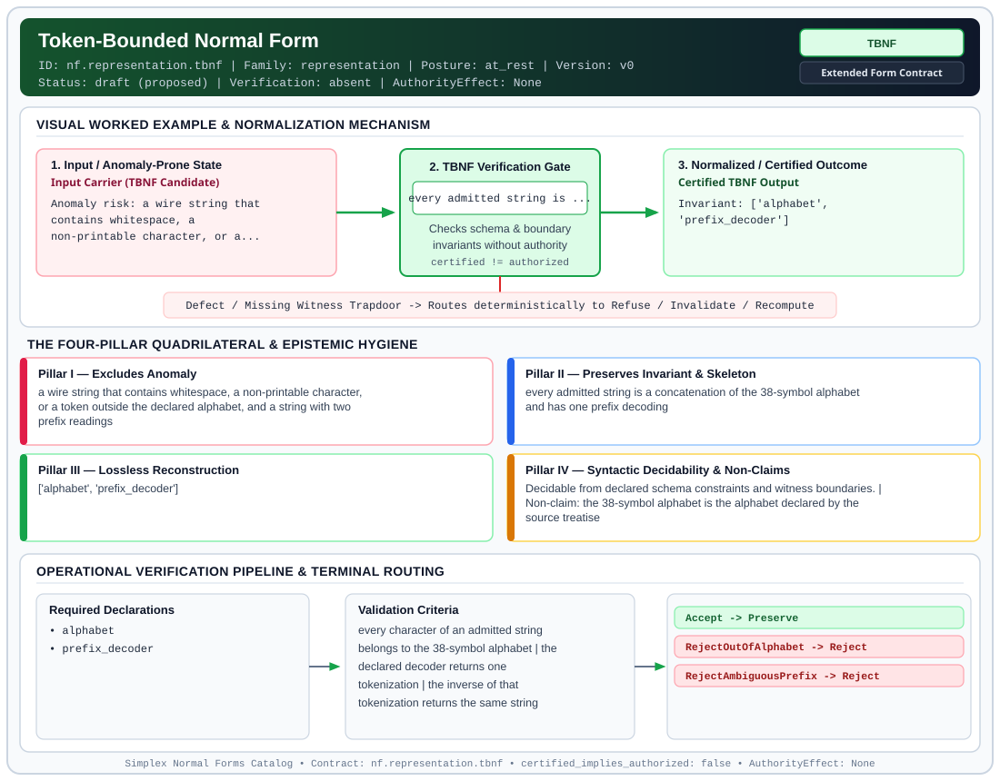

# Token-Bounded Normal Form (`TBNF`)

> **Contract ID:** `nf.representation.tbnf` | **Family:** `representation` | **Index Status:** `draft` | **AuthorityEffect:** `None`

**[⬅ Back to Wiki Home](Home)** | **[View SVG Diagram](images/nf.representation.tbnf.svg)**

---

## 1. Executive Summary & Metadata

Token-Bounded Normal Form (TBNF) enforces structural normalization and explicit defect routing in the representation regime.

| Property | Value |
| :--- | :--- |
| **Canonical ID** | `nf.representation.tbnf` |
| **Short Name** | `TBNF` |
| **Full Name** | Token-Bounded Normal Form |
| **Family** | `representation` (Data in Representation, Canonical Wire Grammars, Orbit Representatives & Gauge Fixing) |
| **Qualification** | Extended Form Contract (Normal Form Contract) |
| **Data / Math Posture** | at_rest |
| **Index Status** | `draft` |
| **Theory Status** | `proposed` |
| **Verification Status** | `absent` |
| **Contract Version** | `v0` |
| **Governance Fence** | `AuthorityEffect: None` (`certified_implies_authorized: false`) |

### Foundational Treatise Specification

- **Levels**: Level 0 - 1
- **Spec Files**: ['0_grammar.md', '1_grammar.md']
- **Anomaly Excluded**: Lexical injection and parsing ambiguity from non-printable or out-of-alphabet tokens.
- **Preserved Invariant**: Admitted wire strings strictly composed of 38-token alphabet with unique prefix decodability.
- **Lossless Reconstruction**: Unique bi-directional bijection between structured ASTs and raw byte streams.

---

## 2. Visual Architecture & Normalization Diagram



---

## 3. Concrete Worked Example & Mechanism

### Visual Transition Summary

| Stage | Carrier / Operator | Concrete State / Invariant |
| :--- | :--- | :--- |
| **1. Before / Candidate Input** | `Input Carrier (TBNF Candidate)` | Anomaly risk: a wire string that ; contains whitespace, a ; non-printable character, or a... |
| **2. Normalization / Gate** | `TBNF Verification Gate` | `every admitted string is ...` (`certified_implies_authorized: false`) |
| **3. After / Certified Output** | `Certified TBNF Output` | Invariant: ['alphabet', ; 'prefix_decoder'] |

### Contract-Declared Worked Cases

```yaml
- ref: coda_all_universe/mssn_sn_tower/definitions.md
  section: '3.1'
```

---

## 4. The Four-Pillar Quadrilateral & Non-Claims

Every contract in `simplex-normal-forms` is evaluated against the **Four-Pillar Quadrilateral** defined in `contracts/_golden_nfs/standard.yaml`:

| Pillar | Requirement | Contract Specification for `nf.representation.tbnf` |
| :--- | :--- | :--- |
| **Pillar I: Excludes Anomaly** | Name and eliminate a specific class of data or state defects. | a wire string that contains whitespace, a non-printable character, or a token outside the declared alphabet, and a string with two prefix readings |
| **Pillar II: Preserves Invariant** | State the structural invariant and protected skeleton preserved across transitions. | **Invariant:** every admitted string is a concatenation of the 38-symbol alphabet and has one prefix decoding<br>**Protected Skeleton:** ['alphabet', 'prefix_decoder'] |
| **Pillar III: Lossless Reconstruction** | State the non-loss reconstruction operator (join, direct sum, pullback, or replay). | Lossless reconstruction under declared projection, direct sum, or pullback operators. |
| **Pillar IV: Syntactic Decidability** | State how conformance is decided from declared constraints without unbudgeted scans. | Decidable from declared schema and witness metadata within bounded evaluation budgets. |

### Explicit Non-Claims (`certified_implies_authorized: false`)

- the 38-symbol alphabet is the alphabet declared by the source treatise
- does not supply the production rules of a grammar beyond unique prefix decoding
- does not imply authorization

---

## 5. Operational Verification & Terminal Routing

### 5.1 Required Declarations

- alphabet
- prefix_decoder

### 5.2 Required Evidence

_None declared._

### 5.3 Validation Criteria

| Criterion ID | Name | Condition |
| :--- | :--- | :--- |
| `criterion` | Check | every character of an admitted string belongs to the 38-symbol alphabet |
| `criterion` | Check | the declared decoder returns one tokenization |
| `criterion` | Check | the inverse of that tokenization returns the same string |

### 5.4 Terminal Route Map

Every evaluation terminates in a declared local route mapped to a canonical terminal in `standard.yaml`:

| Local Terminal Route | Canonical Terminal |
| :--- | :--- |
| `Accept` | `Preserve` |
| `RejectOutOfAlphabet` | `Reject` |
| `RejectAmbiguousPrefix` | `Reject` |

### 5.5 Declared Failure Modes

- **symptom**: the string contains a space or a byte outside the alphabet, **diagnosis**: token alphabet violation, **terminal**: RejectOutOfAlphabet
- **symptom**: two token cuts are both accepted by the decoder, **diagnosis**: prefix decoding is not unique, **terminal**: RejectAmbiguousPrefix

---

## 6. Epistemic Claim Hygiene Quadrant

In accordance with the repository's epistemic claim discipline:

1. **What it supports:**
   - Supports syntactic and operational checking of `nf.representation.tbnf` (`TBNF`) against its declared schema, boundary constraints, and witness obligations in this model.
   - Supports deterministic terminal routing (`Accept, RejectOutOfAlphabet, RejectAmbiguousPrefix`) when required declarations or invariants fail.
2. **What it does not support:**
   - Does not confer operational authority (`AuthorityEffect: None`, `certified_implies_authorized: false`).
   - Does not claim semantic truth of undeclared external processes or unverified upstream inputs beyond the declaredprotected skeleton.
3. **The narrowest defensible claim:**
   - Within the declared substrate `at_rest`, this contract enforces that `a wire string that contains whitespace, a non-printable character, or a token outside the declared alphabet, and a string with two prefix readings` is either excluded under `every admitted string is a concatenation of the 38-symbol alphabet and has one prefix decoding` or routed to an explicit refusal/recovery terminal.
4. **The next test needed:**
   - Property-based falsification and mutation testing across boundary edge cases and composed multi-step pipelines for `nf.representation.tbnf`.

---

## 7. Canonical YAML Contract (`contracts/nf.representation.tbnf.yaml`)

<details>
<summary><strong>Click to expand full canonical YAML contract (contracts/nf.representation.tbnf.yaml)</strong></summary>

```yaml
schema_version: smplx.nf.contract.v0
schema_ref: ./normal_form_contract_schema.yaml
contract_kind: normal_form_contract
identity:
  id: nf.representation.tbnf
  name: Token-Bounded Normal Form
  short_name: TBNF
  version: v0
  theory_status: proposed
  contract_status: draft
  verification_status: absent
  family: representation
  status: draft
classification:
  hierarchy_level: normal_form
  subject_kind:
  - wire_string
  - token_alphabet
  data_posture: at_rest
  mathematical_posture: operational
purpose:
  excludes_anomaly: a wire string that contains whitespace, a non-printable character,
    or a token outside the declared alphabet, and a string with two prefix readings
  preserves_invariant: every admitted string is a concatenation of the 38-symbol alphabet
    and has one prefix decoding
  protected_skeleton:
  - alphabet
  - prefix_decoder
  erased_structure:
  - whitespace
  - non_printable_bytes
  - out_of_alphabet_tokens
  non_claims:
  - the 38-symbol alphabet is the alphabet declared by the source treatise
  - does not supply the production rules of a grammar beyond unique prefix decoding
  - does not imply authorization
definition:
  source: coda_all_universe/mssn_sn_tower/definitions.md
  section: '3.1'
  formal_statement: 'The alphabet is the 26 letters a through z, the 10 digits 0 through
    9, and the two brackets < and >. An admitted wire string is a finite concatenation
    of that alphabet. The declared decoder has exactly one way to cut the string into
    tokens. The structured value and the byte string determine each other.

    '
  quadrilateral:
    qualifies_as_true_normal_form: false
    qualification_gap: reconstruction_is_a_decoding_bijection_not_a_relational_join
    qualifies_as_extended_form: true
    anomaly_exclusion: lexical injection and an ambiguous parse
    lossless_join:
      status: decoding_bijection
      statement: the decoder and its inverse relate structured values and admitted
        byte strings in both directions
    dependency_preservation:
      status: alphabet_membership_retained
      statement: decoding does not introduce a symbol outside the alphabet
    syntactic_decision:
      status: schema_decidable
      statement: membership is the alphabet check plus the unique-prefix check on
        the declared decoder
declarations_required:
- alphabet
- prefix_decoder
evidence_required: []
validation_criteria:
- every character of an admitted string belongs to the 38-symbol alphabet
- the declared decoder returns one tokenization
- the inverse of that tokenization returns the same string
terminal_routes:
- Accept
- RejectOutOfAlphabet
- RejectAmbiguousPrefix
terminal_route_map:
  Accept: Preserve
  RejectOutOfAlphabet: Reject
  RejectAmbiguousPrefix: Reject
certification:
  certificate_required: false
  certificate_kind: null
  obstruction_class_required: false
  loss_ledger_required: false
  verifier_required: false
  loss_ledger_trigger_id: null
authorization:
  authorized_by: null
  certified_implies_authorized: false
failure_modes:
- symptom: the string contains a space or a byte outside the alphabet
  diagnosis: token alphabet violation
  terminal: RejectOutOfAlphabet
- symptom: two token cuts are both accepted by the decoder
  diagnosis: prefix decoding is not unique
  terminal: RejectAmbiguousPrefix
examples:
- ref: coda_all_universe/mssn_sn_tower/definitions.md
  section: '3.1'
references:
- coda_all_universe/mssn_sn_tower/definitions.md
```

</details>
