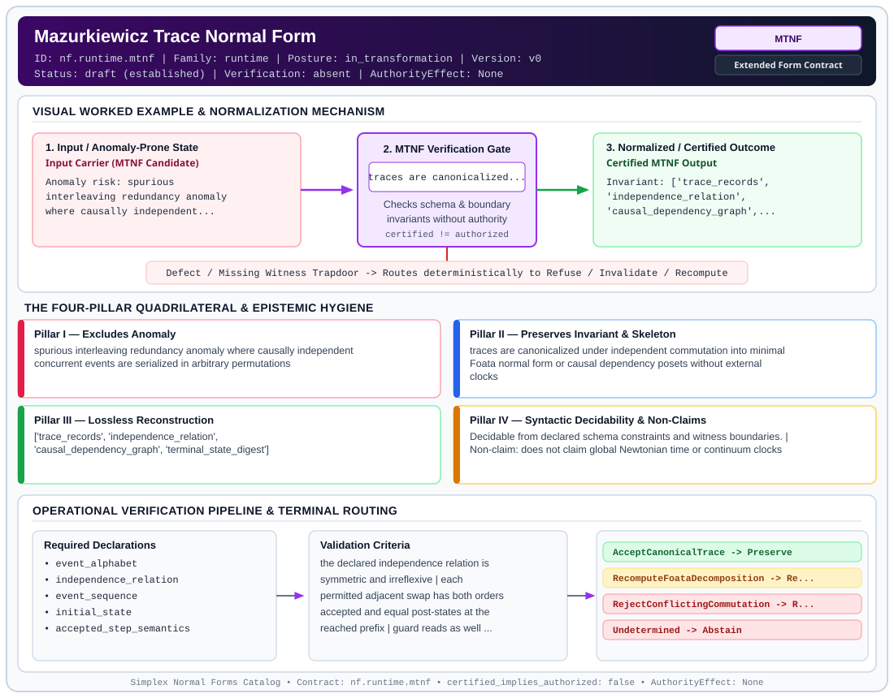

# Mazurkiewicz Trace Normal Form (`MTNF`)

> **Contract ID:** `nf.runtime.mtnf` | **Family:** `runtime` | **Index Status:** `draft` | **AuthorityEffect:** `None`

**[⬅ Back to Wiki Home](Home)** | **[View SVG Diagram](images/nf.runtime.mtnf.svg)**

---

## 1. Executive Summary & Metadata

Mazurkiewicz Trace Normal Form (MTNF) enforces structural normalization and explicit defect routing in the runtime regime.

| Property | Value |
| :--- | :--- |
| **Canonical ID** | `nf.runtime.mtnf` |
| **Short Name** | `MTNF` |
| **Full Name** | Mazurkiewicz Trace Normal Form |
| **Family** | `runtime` (Exact Rational Zero-Duality-Gap Certifiers & Merkle Trace Execution Contracts) |
| **Qualification** | Extended Form Contract (Normal Form Contract) |
| **Data / Math Posture** | in_transformation |
| **Index Status** | `draft` |
| **Theory Status** | `established` |
| **Verification Status** | `absent` |
| **Contract Version** | `v0` |
| **Governance Fence** | `AuthorityEffect: None` (`certified_implies_authorized: false`) |

---

## 2. Visual Architecture & Normalization Diagram



---

## 3. Concrete Worked Example & Mechanism

### Visual Transition Summary

| Stage | Carrier / Operator | Concrete State / Invariant |
| :--- | :--- | :--- |
| **1. Before / Candidate Input** | `Input Carrier (MTNF Candidate)` | Anomaly risk: spurious ; interleaving redundancy anomaly ; where causally independent... |
| **2. Normalization / Gate** | `MTNF Verification Gate` | `traces are canonicalized...` (`certified_implies_authorized: false`) |
| **3. After / Certified Output** | `Certified MTNF Output` | Invariant: ['trace_records', ; 'independence_relation', ; 'causal_dependency_graph',... |

### Contract-Declared Worked Cases

```yaml
- ref: https://github.com/dbccpage/19L57G1/blob/f1d56c010e6ba10a3b9418bd7cc5953c067250f2/lean4/Derivation/TraceAlgebra.lean
  section: lean4/Derivation/TraceAlgebra.lean
  note: independent event commutation and trace equivalence
```

---

## 4. The Four-Pillar Quadrilateral & Non-Claims

Every contract in `simplex-normal-forms` is evaluated against the **Four-Pillar Quadrilateral** defined in `contracts/_golden_nfs/standard.yaml`:

| Pillar | Requirement | Contract Specification for `nf.runtime.mtnf` |
| :--- | :--- | :--- |
| **Pillar I: Excludes Anomaly** | Name and eliminate a specific class of data or state defects. | spurious interleaving redundancy anomaly where causally independent concurrent events are serialized in arbitrary permutations |
| **Pillar II: Preserves Invariant** | State the structural invariant and protected skeleton preserved across transitions. | **Invariant:** traces are canonicalized under independent commutation into minimal Foata normal form or causal dependency posets without external clocks<br>**Protected Skeleton:** ['trace_records', 'independence_relation', 'causal_dependency_graph', 'terminal_state_digest'] |
| **Pillar III: Lossless Reconstruction** | State the non-loss reconstruction operator (join, direct sum, pullback, or replay). | Lossless reconstruction under declared projection, direct sum, or pullback operators. |
| **Pillar IV: Syntactic Decidability** | State how conformance is decided from declared constraints without unbudgeted scans. | Decidable from declared schema and witness metadata within bounded evaluation budgets. |

### Explicit Non-Claims (`certified_implies_authorized: false`)

- does not claim global Newtonian time or continuum clocks
- does not commute events with overlapping state store writes
- does not bypass step-level guard discharges
- does not imply operational authority

---

## 5. Operational Verification & Terminal Routing

### 5.1 Required Declarations

- event_alphabet
- independence_relation
- event_sequence
- initial_state
- accepted_step_semantics
- guard_read_and_write_footprints

### 5.2 Required Evidence

- transition_records
- commutation_proof_receipt
- foata_normal_form_blocks

### 5.3 Validation Criteria

| Criterion ID | Name | Condition |
| :--- | :--- | :--- |
| `criterion` | Check | the declared independence relation is symmetric and irreflexive |
| `criterion` | Check | each permitted adjacent swap has both orders accepted and equal post-states at the reached prefix |
| `criterion` | Check | guard reads as well as writes are included in any footprint argument |
| `criterion` | Check | trace representation matches the declared Foata block decomposition |

### 5.4 Terminal Route Map

Every evaluation terminates in a declared local route mapped to a canonical terminal in `standard.yaml`:

| Local Terminal Route | Canonical Terminal |
| :--- | :--- |
| `AcceptCanonicalTrace` | `Preserve` |
| `RecomputeFoataDecomposition` | `Recompute` |
| `RejectConflictingCommutation` | `Reject` |
| `Undetermined` | `Abstain` |

### 5.5 Declared Failure Modes

- **symptom**: events modifying overlapping state stores are commuted, **diagnosis**: commutation violates causal dependence, **terminal**: RejectConflictingCommutation
- **symptom**: trace is presented in an un-normalized interleaving, **diagnosis**: trace was not reduced to its Foata normal form, **terminal**: RecomputeFoataDecomposition

---

## 6. Epistemic Claim Hygiene Quadrant

In accordance with the repository's epistemic claim discipline:

1. **What it supports:**
   - Supports syntactic and operational checking of `nf.runtime.mtnf` (`MTNF`) against its declared schema, boundary constraints, and witness obligations in this model.
   - Supports deterministic terminal routing (`AcceptCanonicalTrace, RecomputeFoataDecomposition, RejectConflictingCommutation, Undetermined`) when required declarations or invariants fail.
2. **What it does not support:**
   - Does not confer operational authority (`AuthorityEffect: None`, `certified_implies_authorized: false`).
   - Does not claim semantic truth of undeclared external processes or unverified upstream inputs beyond the declaredprotected skeleton.
3. **The narrowest defensible claim:**
   - Within the declared substrate `in_transformation`, this contract enforces that `spurious interleaving redundancy anomaly where causally independent concurrent events are serialized in arbitrary permutations` is either excluded under `traces are canonicalized under independent commutation into minimal Foata normal form or causal dependency posets without external clocks` or routed to an explicit refusal/recovery terminal.
4. **The next test needed:**
   - Property-based falsification and mutation testing across boundary edge cases and composed multi-step pipelines for `nf.runtime.mtnf`.

---

## 7. Canonical YAML Contract (`contracts/nf.runtime.mtnf.yaml`)

<details>
<summary><strong>Click to expand full canonical YAML contract (contracts/nf.runtime.mtnf.yaml)</strong></summary>

```yaml
# Draft declaration: no bound local contract evaluator is supplied; upstream mathematics and schema checks are separate evidence.
schema_version: smplx.nf.contract.v0
contract_kind: form_contract
identity:
  id: nf.runtime.mtnf
  name: Mazurkiewicz Trace Normal Form
  short_name: MTNF
  version: v0
  status: draft
  family: runtime
  theory_status: established
  contract_status: draft
  verification_status: absent
classification:
  hierarchy_level: form
  subject_kind:
  - event_trace
  - causal_partial_order
  - mazurkiewicz_monoid
  data_posture: in_transformation
  mathematical_posture: operational
purpose:
  excludes_anomaly: spurious interleaving redundancy anomaly where causally independent concurrent events
    are serialized in arbitrary permutations
  preserves_invariant: traces are canonicalized under independent commutation into minimal Foata normal
    form or causal dependency posets without external clocks
  protected_skeleton:
  - trace_records
  - independence_relation
  - causal_dependency_graph
  - terminal_state_digest
  erased_structure:
  - arbitrary_sequential_serialization_order
  non_claims:
  - does not claim global Newtonian time or continuum clocks
  - does not commute events with overlapping state store writes
  - does not bypass step-level guard discharges
  - does not imply operational authority
quadrilateral:
  qualifies_as_true_normal_form: false
  qualification_gap: no_project_join_theorem
  anomaly_exclusion: combinatorial trace proliferation from serializing non-interfering independent events
    in arbitrary orders
  lossless_join:
    status: poset_replay_reconstruction
    statement: under the accepted-swap diamond premises, every linearization of the declared dependency
      poset replays to the same endpoint; original interleaving needs retained history
  dependency_preservation:
    status: causal_order_preserved
    statement: conflicting events sharing state stores retain strict serial order
  syntactic_decision:
    status: declaration_decidable
    statement: finite independence-table and trace checks; semantic independence needs the declared accepted-step
      commutation evidence
declarations_required:
- event_alphabet
- independence_relation
- event_sequence
- initial_state
- accepted_step_semantics
- guard_read_and_write_footprints
evidence_required:
- transition_records
- commutation_proof_receipt
- foata_normal_form_blocks
validation_criteria:
- the declared independence relation is symmetric and irreflexive
- each permitted adjacent swap has both orders accepted and equal post-states at the reached prefix
- guard reads as well as writes are included in any footprint argument
- trace representation matches the declared Foata block decomposition
terminal_routes:
- AcceptCanonicalTrace
- RecomputeFoataDecomposition
- RejectConflictingCommutation
- Undetermined
terminal_route_map:
  AcceptCanonicalTrace: Preserve
  RecomputeFoataDecomposition: Recompute
  RejectConflictingCommutation: Reject
  Undetermined: Abstain
certification:
  certificate_required: true
  certificate_kind: trace_commutation_certificate
  obstruction_class_required: false
  loss_ledger_required: false
  verifier_required: true
authorization:
  authorized_by: null
  certified_implies_authorized: false
failure_modes:
- symptom: events modifying overlapping state stores are commuted
  diagnosis: commutation violates causal dependence
  terminal: RejectConflictingCommutation
- symptom: trace is presented in an un-normalized interleaving
  diagnosis: trace was not reduced to its Foata normal form
  terminal: RecomputeFoataDecomposition
examples:
- ref: https://github.com/dbccpage/19L57G1/blob/f1d56c010e6ba10a3b9418bd7cc5953c067250f2/lean4/Derivation/TraceAlgebra.lean
  section: lean4/Derivation/TraceAlgebra.lean
  note: independent event commutation and trace equivalence
references:
- https://github.com/dbccpage/19L57G1/blob/f1d56c010e6ba10a3b9418bd7cc5953c067250f2/docs/GENESIS_CLOSEOUT.md
- ./README.md
```

</details>
