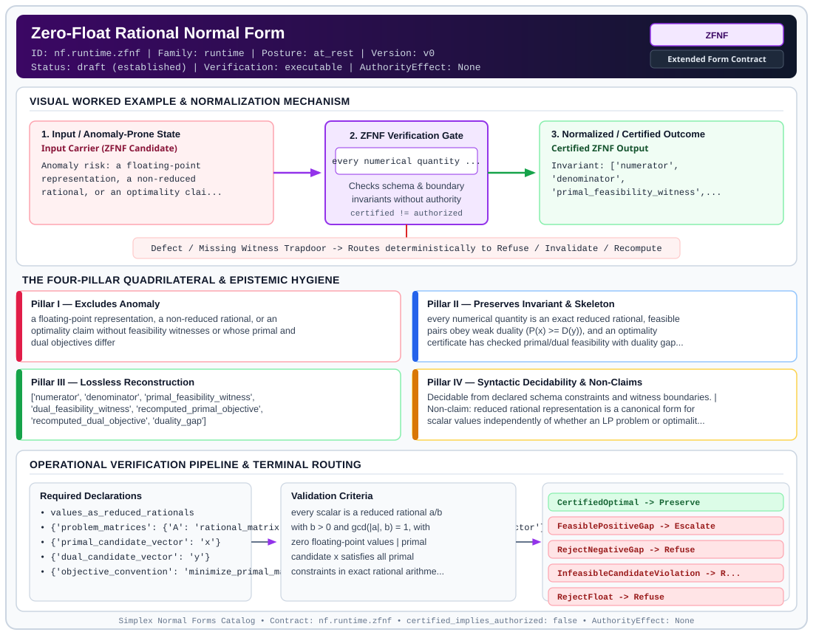

# Zero-Float Rational Normal Form (`ZFNF`)

> **Contract ID:** `nf.runtime.zfnf` | **Family:** `runtime` | **Index Status:** `draft` | **AuthorityEffect:** `None`

**[⬅ Back to Wiki Home](Home)** | **[View SVG Diagram](images/nf.runtime.zfnf.svg)**

---

## 1. Executive Summary & Metadata

Zero-Float Rational Normal Form (ZFNF) enforces structural normalization and explicit defect routing in the runtime regime.

| Property | Value |
| :--- | :--- |
| **Canonical ID** | `nf.runtime.zfnf` |
| **Short Name** | `ZFNF` |
| **Full Name** | Zero-Float Rational Normal Form |
| **Family** | `runtime` (Exact Rational Zero-Duality-Gap Certifiers & Merkle Trace Execution Contracts) |
| **Qualification** | Extended Form Contract (Normal Form Contract) |
| **Data / Math Posture** | at_rest |
| **Index Status** | `draft` |
| **Theory Status** | `established` |
| **Verification Status** | `executable` |
| **Contract Version** | `v0` |
| **Governance Fence** | `AuthorityEffect: None` (`certified_implies_authorized: false`) |

### Foundational Treatise Specification

- **Levels**: Level 18
- **Spec Files**: ['11_grammar.md', '18_math.md']
- **Anomaly Excluded**: Floating-point rounding drift, artificial epsilon tolerances, and false optimality certification.
- **Preserved Invariant**: All vectors, weights, and dual certificates represented as exact rationals q = a/b in Q with zero duality gap.
- **Lossless Reconstruction**: Integer scaling under least common denominators preserves full arithmetic exactness.

---

## 2. Visual Architecture & Normalization Diagram



---

## 3. Concrete Worked Example & Mechanism

### Visual Transition Summary

| Stage | Carrier / Operator | Concrete State / Invariant |
| :--- | :--- | :--- |
| **1. Before / Candidate Input** | `Input Carrier (ZFNF Candidate)` | Anomaly risk: a floating-point ; representation, a non-reduced ; rational, or an optimality clai... |
| **2. Normalization / Gate** | `ZFNF Verification Gate` | `every numerical quantity ...` (`certified_implies_authorized: false`) |
| **3. After / Certified Output** | `Certified ZFNF Output` | Invariant: ['numerator', ; 'denominator', ; 'primal_feasibility_witness',... |

### Contract-Declared Worked Cases

```yaml
- ref: coda_all_universe/mssn_sn_tower/definitions.md
  section: '3.6'
```

---

## 4. The Four-Pillar Quadrilateral & Non-Claims

Every contract in `simplex-normal-forms` is evaluated against the **Four-Pillar Quadrilateral** defined in `contracts/_golden_nfs/standard.yaml`:

| Pillar | Requirement | Contract Specification for `nf.runtime.zfnf` |
| :--- | :--- | :--- |
| **Pillar I: Excludes Anomaly** | Name and eliminate a specific class of data or state defects. | a floating-point representation, a non-reduced rational, or an optimality claim without feasibility witnesses or whose primal and dual objectives differ |
| **Pillar II: Preserves Invariant** | State the structural invariant and protected skeleton preserved across transitions. | **Invariant:** every numerical quantity is an exact reduced rational, feasible pairs obey weak duality (P(x) >= D(y)), and an optimality certificate has checked primal/dual feasibility with duality gap exactly zero (P(x) - D(y) = 0)<br>**Protected Skeleton:** ['numerator', 'denominator', 'primal_feasibility_witness', 'dual_feasibility_witness', 'recomputed_primal_objective', 'recomputed_dual_objective', 'duality_gap'] |
| **Pillar III: Lossless Reconstruction** | State the non-loss reconstruction operator (join, direct sum, pullback, or replay). | Lossless reconstruction under declared projection, direct sum, or pullback operators. |
| **Pillar IV: Syntactic Decidability** | State how conformance is decided from declared constraints without unbudgeted scans. | Decidable from declared schema and witness metadata within bounded evaluation budgets. |

### Explicit Non-Claims (`certified_implies_authorized: false`)

- reduced rational representation is a canonical form for scalar values independently of whether an LP problem or optimality certificate is declared
- weak duality and the zero-gap optimality certificate are distinct statements. For minimization primal P(x) and maximization dual D(y), weak duality establishes D(y) <= P(x) for all feasible pairs, so the nonnegative duality gap is g = P(x) - D(y) >= 0. A positive gap g > 0 denotes a feasible suboptimal pair; g = 0 with verified feasibility certifies optimality
- equal objective numbers without checked primal and dual feasibility witnesses do not certify optimality (infeasible pairs can have equal objective values)
- a finite binary float mathematically denotes a rational number, but violates the repository's exact rational representation policy and arithmetic path
- does not imply authorization (AuthorityEffect: None)

---

## 5. Operational Verification & Terminal Routing

### 5.1 Required Declarations

- values_as_reduced_rationals
- **problem_matrices**: {'A': 'rational_matrix', 'b': 'rational_vector', 'c': 'rational_vector'}
- **primal_candidate_vector**: x
- **dual_candidate_vector**: y
- **objective_convention**: minimize_primal_maximize_dual

### 5.2 Required Evidence

- **primal_feasibility_check**: evaluation that x satisfies primal constraints Ax >= b, x >= 0
- **dual_feasibility_check**: evaluation that y satisfies dual constraints A^T y <= c, y >= 0
- **recomputed_primal_objective**: c^T x in Q
- **recomputed_dual_objective**: b^T y in Q
- **recomputed_duality_gap**: P(x) - D(y) in Q

### 5.3 Validation Criteria

| Criterion ID | Name | Condition |
| :--- | :--- | :--- |
| `criterion` | Check | every scalar is a reduced rational a/b with b > 0 and gcd(|a|, b) = 1, with zero floating-point values |
| `criterion` | Check | primal candidate x satisfies all primal constraints in exact rational arithmetic |
| `criterion` | Check | dual candidate y satisfies all dual constraints in exact rational arithmetic |
| `criterion` | Check | under minimization primal and maximization dual, weak duality P(x) - D(y) >= 0 is verified |
| `criterion` | Check | an optimality certificate has both candidates feasible and duality gap P(x) - D(y) == 0 |
| `criterion` | Check | any gap violation P(x) - D(y) < 0 or candidate infeasibility is refused |

### 5.4 Terminal Route Map

Every evaluation terminates in a declared local route mapped to a canonical terminal in `standard.yaml`:

| Local Terminal Route | Canonical Terminal |
| :--- | :--- |
| `CertifiedOptimal` | `Preserve` |
| `FeasiblePositiveGap` | `Escalate` |
| `RejectNegativeGap` | `Refuse` |
| `InfeasibleCandidateViolation` | `Refuse` |
| `RejectFloat` | `Refuse` |

### 5.5 Declared Failure Modes

- **symptom**: a value is represented as a binary or decimal floating-point number, **diagnosis**: forbidden representation policy; floating-point representation or inexact arithmetic path detected where exact reduced rational is required, **terminal**: RejectFloat
- **symptom**: candidate vector fails primal or dual feasibility constraints, **diagnosis**: candidate is infeasible; equal objective values cannot certify optimality without verified feasibility, **terminal**: InfeasibleCandidateViolation
- **symptom**: the primal objective is strictly less than the dual objective (P(x) - D(y) < 0), **diagnosis**: weak duality violated for declared minimize_primal_maximize_dual convention (indicates formulation defect or infeasibility), **terminal**: RejectNegativeGap
- **symptom**: candidates are feasible and the gap g = P(x) - D(y) is a strictly positive rational, **diagnosis**: the pair is feasible but suboptimal; gap remains unclosed, **terminal**: FeasiblePositiveGap

---

## Deep-Dive Level Treatise

**AuthorityEffect:** None.  
**Level:** Level 20 (Operational Substrate / Exact Rational Primal-Dual Witness Certification)  
**Evidential Grade:** NATIVE IMPLEMENTED  
**Contract Reference:** [`nf.runtime.zfnf`](../../../../omega_engine_pfp/infrastructure/yaml/normal_forms/nf.runtime.zfnf.yaml)  
**Mathematical Posture:** Primal-Dual Linear Programming & Exact Duality Certificates  
**Data Posture:** Runtime / Operational  

---

## 1. Schematic & Conceptual Architecture

Zero-Duality-Gap Normal Form (ZFNF) provides unforgeable mathematical proofs of **optimality and termination**:
- For any discrete optimization or resource allocation problem, floating-point convergence is untrusted.
- ZFNF requires a paired **primal candidate** $x^*$ and **dual witness** $y^*$ in exact rational arithmetic ($\mathbb{Q}$).
- When primal feasibility, dual feasibility, and objective value equality are verified, the **duality gap is zero**:
  $$\text{Duality Gap} = c^T x^* - b^T y^* = 0$$
- This certifies that $x^*$ is globally optimal without requiring the verifier to trust the search algorithm.

```text
       Primal Candidate x*                 Dual Witness y*
  ┌───────────────────────────┐       ┌───────────────────────────┐
  │ Primal Feasible: A x* <= b│       │ Dual Feasible: A^T y* >= c│
  │ Objective Value: c^T x*   │       │ Objective Value: b^T y*   │
  └─────────────┬─────────────┘       └─────────────┬─────────────┘
                │                                   │
                └───────────────┬───────────────────┘
                                ▼
                   Zero Duality Gap Certificate
                     c^T x* - b^T y* = 0  (Exact in Q!)
```

---

## 2. Mathematical Invariants & Quadrilateral Properties

1. **Strong Duality Theorem & Verification Conditions:**
   A candidate solution is certified in ZFNF if and only if all three conditions hold simultaneously:
   - **Primal Feasibility:** $A x^* \le b$ and $x^* \ge 0$.
   - **Dual Feasibility:** $A^T y^* \ge c$, $y^* \ge 0$, and box capacity bounds $|w_e| \le 1$.
   - **Divergence Balance:** Dual flow vectors satisfy conservation $d_0^T w = 0$.
   - **Zero Duality Gap:** $c^T x^* = b^T y^*$ (evaluated in exact `fractions.Fraction`).

2. **The Feasibility Precondition Guard:**
   Numerical equality $c^T x^* = b^T y^*$ alone does **not** certify optimality if feasibility or divergence balance is violated; unbalanced flow vectors can yield spurious numerical equality.

3. **The Quadrilateral Invariants:**
   - **Anomaly Excluded:** Sub-optimal solver termination, floating-point rounding illusions, unverified heuristic outputs.
   - **Protected Skeleton:** Primal objective vectors $c$, dual constraints $b$, and exact rational witness pairs $(x^*, y^*)$.
   - **Erased Structure:** Search trees, branch-and-bound traces, heuristic solver state.
   - **Reconstruction:** Zero-gap certificate validation in $\mathcal{O}(m \cdot n)$ linear time.

---

## 3. Terminal Routes & Verification Logic

```text
Primal-Dual Pair (x*, y*) & Exact Constraints
      │
      ├── Feasible on both sides AND c^T x* = b^T y* ──► Preserve (ZFNFCertified)
      │
      ├── Feasible on both sides BUT c^T x* > b^T y* ──► Quarantine (PositiveDualityGap)
      │
      ├── Primal or dual constraints violated ────────► Reject (InfeasibleCandidate)
      │
      └── Flow vector violates divergence balance ────► Reject (UnbalancedDivergence)
```

---

## 4. Test Evidence & Local Execution

Verified in [`test_nf_review_regressions.py`](../../../tests/normal_forms/test_nf_review_regressions.py) and [`test_tranche13_adversarial_and_rust_parity.py`](../../../tests/normal_forms/test_tranche13_adversarial_and_rust_parity.py):
- `verify_zfnf(primal, dual, constraints)`: Checks exact rational inner products and constraint matrices.
- `test_zfnf_weak_duality_sign`: Asserts that any inverted duality sign ($c^T x^* < b^T y^*$) trips immediate rejection.

---

## 5. Epistemic Claim Quadrant

1. **What it supports:**
   - Independent, polynomial-time verification of NP-hard combinatorial solver solutions.
   - Unforgeable certificates of exact optimality in pure rational arithmetic.
2. **What it does not support:**
   - Non-convex optimization problems where strong duality fails.
3. **The narrowest defensible claim:**
   - ZFNF ensures under declared assumptions that the candidate solution cannot be improved by any feasible vector.
4. **The next test needed:**
   - Rust-Python cross-language verification verifying that integer-scaled fixed-point certifiers match Python `fractions.Fraction` bit-for-bit.

---

## 6. Epistemic Claim Hygiene Quadrant

In accordance with the repository's epistemic claim discipline:

1. **What it supports:**
   - Supports syntactic and operational checking of `nf.runtime.zfnf` (`ZFNF`) against its declared schema, boundary constraints, and witness obligations in this model.
   - Supports deterministic terminal routing (`CertifiedOptimal, FeasiblePositiveGap, RejectNegativeGap, InfeasibleCandidateViolation`) when required declarations or invariants fail.
2. **What it does not support:**
   - Does not confer operational authority (`AuthorityEffect: None`, `certified_implies_authorized: false`).
   - Does not claim semantic truth of undeclared external processes or unverified upstream inputs beyond the declaredprotected skeleton.
3. **The narrowest defensible claim:**
   - Within the declared substrate `at_rest`, this contract enforces that `a floating-point representation, a non-reduced rational, or an optimality claim without feasibility witnesses or whose primal and dual objectives differ` is either excluded under `every numerical quantity is an exact reduced rational, feasible pairs obey weak duality (P(x) >= D(y)), and an optimality certificate has checked primal/dual feasibility with duality gap exactly zero (P(x) - D(y) = 0)` or routed to an explicit refusal/recovery terminal.
4. **The next test needed:**
   - Property-based falsification and mutation testing across boundary edge cases and composed multi-step pipelines for `nf.runtime.zfnf`.

---

## 7. Canonical YAML Contract (`contracts/nf.runtime.zfnf.yaml`)

<details>
<summary><strong>Click to expand full canonical YAML contract (contracts/nf.runtime.zfnf.yaml)</strong></summary>

```yaml
schema_version: smplx.nf.contract.v0
schema_ref: ./normal_form_contract_schema.yaml
contract_kind: normal_form_contract
identity:
  id: nf.runtime.zfnf
  name: Zero-Float Rational Normal Form
  short_name: ZFNF
  version: v0
  theory_status: established
  contract_status: draft
  verification_status: executable
  family: runtime
  status: draft
classification:
  hierarchy_level: normal_form
  subject_kind:
  - rational_number
  - primal_dual_pair
  data_posture: at_rest
  mathematical_posture: formal_algebraic
purpose:
  excludes_anomaly: a floating-point representation, a non-reduced rational, or an optimality
    claim without feasibility witnesses or whose primal and dual objectives differ
  preserves_invariant: every numerical quantity is an exact reduced rational, feasible pairs
    obey weak duality (P(x) >= D(y)), and an optimality certificate has checked primal/dual
    feasibility with duality gap exactly zero (P(x) - D(y) = 0)
  protected_skeleton:
  - numerator
  - denominator
  - primal_feasibility_witness
  - dual_feasibility_witness
  - recomputed_primal_objective
  - recomputed_dual_objective
  - duality_gap
  erased_structure:
  - floating_point_representations
  - unreduced_denominators
  non_claims:
  - reduced rational representation is a canonical form for scalar values independently of whether
    an LP problem or optimality certificate is declared
  - weak duality and the zero-gap optimality certificate are distinct statements. For minimization
    primal P(x) and maximization dual D(y), weak duality establishes D(y) <= P(x) for all feasible
    pairs, so the nonnegative duality gap is g = P(x) - D(y) >= 0. A positive gap g > 0 denotes a
    feasible suboptimal pair; g = 0 with verified feasibility certifies optimality
  - equal objective numbers without checked primal and dual feasibility witnesses do not certify
    optimality (infeasible pairs can have equal objective values)
  - a finite binary float mathematically denotes a rational number, but violates the repository's
    exact rational representation policy and arithmetic path
  - "does not imply authorization (AuthorityEffect: None)"
definition:
  source: coda_all_universe/mssn_sn_tower/definitions.md
  section: '3.6'
  formal_statement: >
    Each scalar is canonically represented as an irreducible rational a/b with b in Z_{>0}
    and gcd(|a|, b) = 1. For a linear program with declared convention minimize_primal_maximize_dual,
    candidate vectors x and y must satisfy independently checked primal feasibility (Ax >= b, x >= 0)
    and dual feasibility (A^T y <= c, y >= 0). Under weak duality, the dual objective D(y) = b^T y
    provides a lower bound on the primal objective P(x) = c^T x, so the exact duality gap
    g = P(x) - D(y) satisfies g >= 0. The pair (x, y) constitutes an optimality certificate if and
    only if both candidates are feasible and g = 0. A negative gap P(x) - D(y) < 0 indicates a
    duality formulation error or infeasible candidate.
  quadrilateral:
    qualifies_as_true_normal_form: false
    qualification_gap: reconstruction_is_exact_arithmetic_not_a_relational_join
    qualifies_as_extended_form: true
    anomaly_exclusion: rounding drift, inexact float representation, and optimality claims lacking
      verified feasibility or having non-zero duality gap
    lossless_join:
      status: denominator_clearing
      statement: integer scaling by a positive common multiple preserves rational equalities
        and polyhedral ordering
    dependency_preservation:
      status: reduced_form_retained
      statement: each rational is stored in canonical reduced form, and floating-point representations
        are prohibited across the execution pipeline
    syntactic_decision:
      status: schema_decidable
      statement: reduction, feasibility checking, and exact rational arithmetic evaluation of the
        gap g = P(x) - D(y) are decidable operations on finite rational data
declarations_required:
- values_as_reduced_rationals
- problem_matrices: {A: rational_matrix, b: rational_vector, c: rational_vector}
- primal_candidate_vector: x
- dual_candidate_vector: y
- objective_convention: minimize_primal_maximize_dual
evidence_required:
- primal_feasibility_check: evaluation that x satisfies primal constraints Ax >= b, x >= 0
- dual_feasibility_check: evaluation that y satisfies dual constraints A^T y <= c, y >= 0
- recomputed_primal_objective: c^T x in Q
- recomputed_dual_objective: b^T y in Q
- recomputed_duality_gap: P(x) - D(y) in Q
validation_criteria:
- every scalar is a reduced rational a/b with b > 0 and gcd(|a|, b) = 1, with zero floating-point values
- primal candidate x satisfies all primal constraints in exact rational arithmetic
- dual candidate y satisfies all dual constraints in exact rational arithmetic
- under minimization primal and maximization dual, weak duality P(x) - D(y) >= 0 is verified
- an optimality certificate has both candidates feasible and duality gap P(x) - D(y) == 0
- any gap violation P(x) - D(y) < 0 or candidate infeasibility is refused
terminal_routes:
- CertifiedOptimal
- FeasiblePositiveGap
- RejectNegativeGap
- InfeasibleCandidateViolation
- RejectFloat
terminal_route_map:
  CertifiedOptimal: Preserve
  FeasiblePositiveGap: Escalate
  RejectNegativeGap: Refuse
  InfeasibleCandidateViolation: Refuse
  RejectFloat: Refuse
certification:
  certificate_required: true
  certificate_kind: exact_rational_primal_dual_certificate
  obstruction_class_required: true
  loss_ledger_required: false
  verifier_required: true
  loss_ledger_trigger_id: null
authorization:
  authorized_by: null
  certified_implies_authorized: false
failure_modes:
- symptom: a value is represented as a binary or decimal floating-point number
  diagnosis: forbidden representation policy; floating-point representation or inexact arithmetic path detected where exact reduced rational is required
  terminal: RejectFloat
- symptom: candidate vector fails primal or dual feasibility constraints
  diagnosis: candidate is infeasible; equal objective values cannot certify optimality without verified feasibility
  terminal: InfeasibleCandidateViolation
- symptom: the primal objective is strictly less than the dual objective (P(x) - D(y) < 0)
  diagnosis: weak duality violated for declared minimize_primal_maximize_dual convention (indicates formulation defect or infeasibility)
  terminal: RejectNegativeGap
- symptom: candidates are feasible and the gap g = P(x) - D(y) is a strictly positive rational
  diagnosis: the pair is feasible but suboptimal; gap remains unclosed
  terminal: FeasiblePositiveGap
examples:
- ref: coda_all_universe/mssn_sn_tower/definitions.md
  section: '3.6'
references:
- coda_all_universe/mssn_sn_tower/definitions.md
- https://web.stanford.edu/~boyd/cvxbook/bv_cvxbook.pdf
obstruction_substrate:
  policy_ref: ../substrate/default_finite_obstruction_policy.yaml
  finite_carrier:
    description: LP solution state over rationals Q represented as reduced integer pairs (a, b) with b > 0
    max_rank: null
  cochain_complex:
    description: Polyhedral feasibility and duality gap evaluation over exact rational vector spaces
    C0: primal_dual_candidate_spaces_Q
    C1: constraint_residual_space_Q
    C2: duality_gap_space_Q
  obstruction_class:
    notation: '[duality_gap]'
    exact: feasibility_verified and P(x) - D(y) == 0 (certified primal-dual optimality)
    residual_closed: feasibility_verified and P(x) - D(y) > 0 (suboptimal feasible pair with exact positive gap)
    open: not feasibility_verified or P(x) - D(y) < 0 (infeasible or duality violation)
proof_obligations:
- id: zfnf.zero_float_optimality
  status: theorem_shaped
  ref: ../math/18_math_zero_float_law_and_exact_rational_lp_solvers.md
  section: 1. The Zero-Float Law and Exact Duality
```

</details>
