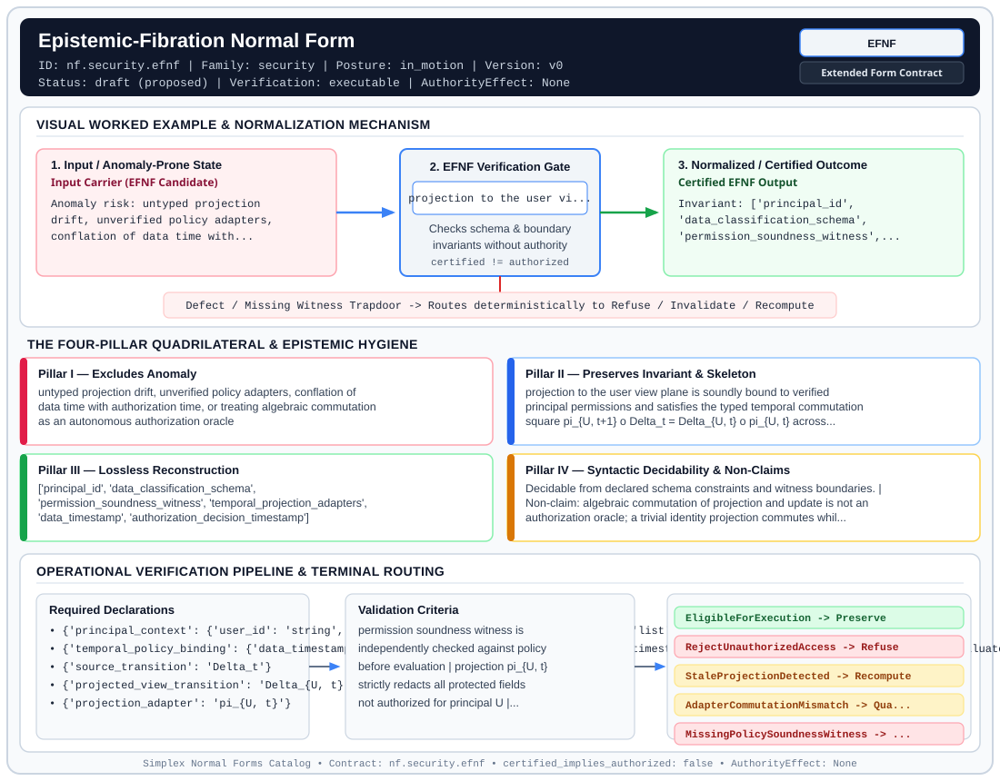

# Epistemic-Fibration Normal Form (`EFNF`)

> **Contract ID:** `nf.security.efnf` | **Family:** `security` | **Index Status:** `draft` | **AuthorityEffect:** `None`

**[⬅ Back to Wiki Home](Home)** | **[View SVG Diagram](images/nf.security.efnf.svg)**

---

## 1. Executive Summary & Metadata

Epistemic-Fibration Normal Form (EFNF) enforces structural normalization and explicit defect routing in the security regime.

| Property | Value |
| :--- | :--- |
| **Canonical ID** | `nf.security.efnf` |
| **Short Name** | `EFNF` |
| **Full Name** | Epistemic-Fibration Normal Form |
| **Family** | `security` (Endogenous Fidelity & Security Boundary Normal Forms) |
| **Qualification** | Extended Form Contract (Normal Form Contract) |
| **Data / Math Posture** | in_motion |
| **Index Status** | `draft` |
| **Theory Status** | `proposed` |
| **Verification Status** | `executable` |
| **Contract Version** | `v0` |
| **Governance Fence** | `AuthorityEffect: None` (`certified_implies_authorized: false`) |

---

## 2. Visual Architecture & Normalization Diagram



---

## 3. Concrete Worked Example & Mechanism

### Visual Transition Summary

| Stage | Carrier / Operator | Concrete State / Invariant |
| :--- | :--- | :--- |
| **1. Before / Candidate Input** | `Input Carrier (EFNF Candidate)` | Anomaly risk: untyped projection ; drift, unverified policy adapters, ; conflation of data time with... |
| **2. Normalization / Gate** | `EFNF Verification Gate` | `projection to the user vi...` (`certified_implies_authorized: false`) |
| **3. After / Certified Output** | `Certified EFNF Output` | Invariant: ['principal_id', ; 'data_classification_schema', ; 'permission_soundness_witness',... |

### Contract-Declared Worked Cases

```yaml
- ref: coda_all_universe/mssn_sn_tower/definitions.md
  section: '3.10'
```

---

## 4. The Four-Pillar Quadrilateral & Non-Claims

Every contract in `simplex-normal-forms` is evaluated against the **Four-Pillar Quadrilateral** defined in `contracts/_golden_nfs/standard.yaml`:

| Pillar | Requirement | Contract Specification for `nf.security.efnf` |
| :--- | :--- | :--- |
| **Pillar I: Excludes Anomaly** | Name and eliminate a specific class of data or state defects. | untyped projection drift, unverified policy adapters, conflation of data time with authorization time, or treating algebraic commutation as an autonomous authorization oracle |
| **Pillar II: Preserves Invariant** | State the structural invariant and protected skeleton preserved across transitions. | **Invariant:** projection to the user view plane is soundly bound to verified principal permissions and satisfies the typed temporal commutation square pi_{U, t+1} o Delta_t = Delta_{U, t} o pi_{U, t} across historical states<br>**Protected Skeleton:** ['principal_id', 'data_classification_schema', 'permission_soundness_witness', 'temporal_projection_adapters', 'data_timestamp', 'authorization_decision_timestamp'] |
| **Pillar III: Lossless Reconstruction** | State the non-loss reconstruction operator (join, direct sum, pullback, or replay). | Lossless reconstruction under declared projection, direct sum, or pullback operators. |
| **Pillar IV: Syntactic Decidability** | State how conformance is decided from declared constraints without unbudgeted scans. | Decidable from declared schema and witness metadata within bounded evaluation budgets. |

### Explicit Non-Claims (`certified_implies_authorized: false`)

- algebraic commutation of projection and update is not an authorization oracle; a trivial identity projection commutes while exposing protected fields. Commutation is valid only after independent verification of permission-model soundness
- commutation failure indicates a discrepancy (stale projection, invalid view-update adapter, or policy mutation) and does not automatically support an information leak
- does not protect against side-channel timing or statistical inference attacks
- does not confer execution authority; an EligibleForExecution disposition remains inert until an external host authorization decision is supplied (AuthorityEffect: None)

---

## 5. Operational Verification & Terminal Routing

### 5.1 Required Declarations

- **principal_context**: {'user_id': 'string', 'role': 'string', 'authorized_clearances': 'list'}
- **temporal_policy_binding**: {'data_timestamp_basis': 'string', 'authorization_decision_timestamp': 'string', 'policy_evaluation_rule': 'evaluated_at_decision_time'}
- **source_transition**: Delta_t
- **projected_view_transition**: Delta_{U, t}
- **projection_adapter**: pi_{U, t}
- **permission_soundness_witness**: {'policy_rule_id': 'string', 'protected_fields_redacted': 'list', 'allowed_fields_retained': 'list'}

### 5.2 Required Evidence

- **independently_verified_permission_soundness**: boolean
- **source_state_hash_t**: string
- **source_state_hash_t_next**: string
- **projected_view_hash_t**: string
- **projected_view_hash_t_next**: string
- **commutation_discrepancy_norm**: rational_or_int

### 5.3 Validation Criteria

| Criterion ID | Name | Condition |
| :--- | :--- | :--- |
| `criterion` | Check | permission soundness witness is independently checked against policy before evaluation |
| `criterion` | Check | projection pi_{U, t} strictly redacts all protected fields not authorized for principal U |
| `criterion` | Check | authorization time is distinguished from historical data transaction time |
| `criterion` | Check | typed temporal square pi_{U, t+1} o Delta_t == Delta_{U, t} o pi_{U, t} evaluates with zero discrepancy |
| `criterion` | Check | any commutation failure routes to a typed discrepancy terminal without granting execution eligibility |
| `criterion` | Check | execution remains an external host act; contract output only certifies view eligibility |

### 5.4 Terminal Route Map

Every evaluation terminates in a declared local route mapped to a canonical terminal in `standard.yaml`:

| Local Terminal Route | Canonical Terminal |
| :--- | :--- |
| `EligibleForExecution` | `Preserve` |
| `RejectUnauthorizedAccess` | `Refuse` |
| `StaleProjectionDetected` | `Recompute` |
| `AdapterCommutationMismatch` | `Quarantine` |
| `MissingPolicySoundnessWitness` | `Refuse` |

### 5.5 Declared Failure Modes

- **symptom**: permission soundness witness is absent or fails verification, **diagnosis**: unverified projection cannot act as an authorization gate; fails closed, **terminal**: MissingPolicySoundnessWitness
- **symptom**: user context lacks clearance for requested classified attributes, **diagnosis**: explicit permission refusal on protected attributes, **terminal**: RejectUnauthorizedAccess
- **symptom**: projection fails to commute across update due to outdated policy mapping, **diagnosis**: stale projection cache; requires recomputation of projection adapter, **terminal**: StaleProjectionDetected
- **symptom**: source update and projected update produce non-matching target views, **diagnosis**: view-update adapter discrepancy or unmodeled policy shift, **terminal**: AdapterCommutationMismatch

---

## 6. Epistemic Claim Hygiene Quadrant

In accordance with the repository's epistemic claim discipline:

1. **What it supports:**
   - Supports syntactic and operational checking of `nf.security.efnf` (`EFNF`) against its declared schema, boundary constraints, and witness obligations in this model.
   - Supports deterministic terminal routing (`EligibleForExecution, RejectUnauthorizedAccess, StaleProjectionDetected, AdapterCommutationMismatch`) when required declarations or invariants fail.
2. **What it does not support:**
   - Does not confer operational authority (`AuthorityEffect: None`, `certified_implies_authorized: false`).
   - Does not claim semantic truth of undeclared external processes or unverified upstream inputs beyond the declaredprotected skeleton.
3. **The narrowest defensible claim:**
   - Within the declared substrate `in_motion`, this contract enforces that `untyped projection drift, unverified policy adapters, conflation of data time with authorization time, or treating algebraic commutation as an autonomous authorization oracle` is either excluded under `projection to the user view plane is soundly bound to verified principal permissions and satisfies the typed temporal commutation square pi_{U, t+1} o Delta_t = Delta_{U, t} o pi_{U, t} across historical states` or routed to an explicit refusal/recovery terminal.
4. **The next test needed:**
   - Property-based falsification and mutation testing across boundary edge cases and composed multi-step pipelines for `nf.security.efnf`.

---

## 7. Canonical YAML Contract (`contracts/nf.security.efnf.yaml`)

<details>
<summary><strong>Click to expand full canonical YAML contract (contracts/nf.security.efnf.yaml)</strong></summary>

```yaml
schema_version: smplx.nf.contract.v0
schema_ref: ./normal_form_contract_schema.yaml
contract_kind: normal_form_contract

identity:
  id: nf.security.efnf
  name: Epistemic-Fibration Normal Form
  short_name: EFNF
  version: v0
  status: draft
  family: security
  theory_status: proposed
  contract_status: draft
  verification_status: executable

classification:
  hierarchy_level: form
  subject_kind:
    - authorization_filter
    - temporal_view_projection
    - permission_adapter
  data_posture: in_motion
  mathematical_posture: operational

purpose:
  excludes_anomaly: untyped projection drift, unverified policy adapters, conflation
    of data time with authorization time, or treating algebraic commutation as an autonomous
    authorization oracle
  preserves_invariant: projection to the user view plane is soundly bound to verified
    principal permissions and satisfies the typed temporal commutation square
    pi_{U, t+1} o Delta_t = Delta_{U, t} o pi_{U, t} across historical states
  protected_skeleton:
    - principal_id
    - data_classification_schema
    - permission_soundness_witness
    - temporal_projection_adapters
    - data_timestamp
    - authorization_decision_timestamp
  erased_structure:
    - physical_storage_layout
    - partition_offsets
  non_claims:
    - algebraic commutation of projection and update is not an authorization oracle;
      a trivial identity projection commutes while exposing protected fields. Commutation
      is valid only after independent verification of permission-model soundness
    - commutation failure indicates a discrepancy (stale projection, invalid view-update
      adapter, or policy mutation) and does not automatically support an information leak
    - does not protect against side-channel timing or statistical inference attacks
    - "does not confer execution authority; an EligibleForExecution disposition remains
      inert until an external host authorization decision is supplied (AuthorityEffect: None)"

declarations_required:
  - principal_context: {user_id: string, role: string, authorized_clearances: list}
  - temporal_policy_binding:
      data_timestamp_basis: string
      authorization_decision_timestamp: string
      policy_evaluation_rule: evaluated_at_decision_time
  - source_transition: Delta_t
  - projected_view_transition: Delta_{U, t}
  - projection_adapter: pi_{U, t}
  - permission_soundness_witness:
      policy_rule_id: string
      protected_fields_redacted: list
      allowed_fields_retained: list

evidence_required:
  - independently_verified_permission_soundness: boolean
  - source_state_hash_t: string
  - source_state_hash_t_next: string
  - projected_view_hash_t: string
  - projected_view_hash_t_next: string
  - commutation_discrepancy_norm: rational_or_int

validation_criteria:
  - permission soundness witness is independently checked against policy before evaluation
  - projection pi_{U, t} strictly redacts all protected fields not authorized for principal U
  - authorization time is distinguished from historical data transaction time
  - typed temporal square pi_{U, t+1} o Delta_t == Delta_{U, t} o pi_{U, t} evaluates with zero discrepancy
  - any commutation failure routes to a typed discrepancy terminal without granting execution eligibility
  - execution remains an external host act; contract output only certifies view eligibility

proof_obligations:
  - id: efnf.permission_soundness_precondition
    status: open_proof_obligation
    note: Independent verification that pi_U correctly implements declared authorization policy
  - id: efnf.typed_commutation_square
    status: theorem_shaped
    statement: pi_{U, t+1} o Delta_t = Delta_{U, t} o pi_{U, t} holds on all valid transitions under verified sound projections

terminal_routes:
  - EligibleForExecution
  - RejectUnauthorizedAccess
  - StaleProjectionDetected
  - AdapterCommutationMismatch
  - MissingPolicySoundnessWitness

terminal_route_map:
  EligibleForExecution: Preserve
  RejectUnauthorizedAccess: Refuse
  StaleProjectionDetected: Recompute
  AdapterCommutationMismatch: Quarantine
  MissingPolicySoundnessWitness: Refuse

certification:
  certificate_required: true
  certificate_kind: verified_sound_projection_certificate
  obstruction_class_required: true
  loss_ledger_required: false
  loss_ledger_trigger_id: null
  verifier_required: true

authorization:
  authorized_by: null
  certified_implies_authorized: false

failure_modes:
  - symptom: permission soundness witness is absent or fails verification
    diagnosis: unverified projection cannot act as an authorization gate; fails closed
    terminal: MissingPolicySoundnessWitness
  - symptom: user context lacks clearance for requested classified attributes
    diagnosis: explicit permission refusal on protected attributes
    terminal: RejectUnauthorizedAccess
  - symptom: projection fails to commute across update due to outdated policy mapping
    diagnosis: stale projection cache; requires recomputation of projection adapter
    terminal: StaleProjectionDetected
  - symptom: source update and projected update produce non-matching target views
    diagnosis: view-update adapter discrepancy or unmodeled policy shift
    terminal: AdapterCommutationMismatch

examples:
  - ref: coda_all_universe/mssn_sn_tower/definitions.md
    section: "3.10"

references:
  - coda_all_universe/mssn_sn_tower/definitions.md

definition:
  source: coda_all_universe/mssn_sn_tower/definitions.md
  section: "3.10"
  formal_statement: >
    A temporal query projection conforms to Epistemic-Fibration Normal Form if and only if
    the projection pi_{U, t} is independently certified sound against policy for principal U,
    and satisfies the typed temporal commutation condition pi_{U, t+1} o Delta_t = Delta_{U, t} o pi_{U, t}
    across successive state transitions. Commutation without certified policy soundness is
    inert and rejected.
  quadrilateral:
    qualifies_as_true_normal_form: false
    qualification_gap: reconstruction_is_sound_view_projection_not_relational_project_join
    qualifies_as_extended_form: true
    anomaly_exclusion: unauthorized temporal leakage, unverified projection policies, and false-authorization by commutation
    lossless_join:
      status: certified_sound_projection
      statement: sound projection filters reconstruct authorized views preserving declared access constraints
    dependency_preservation:
      status: temporal_square_preserved
      statement: access control policies remain evaluable across historical query transitions
    syntactic_decision:
      status: schema_decidable
      statement: policy soundness and finite commutation checks are decidable on declared schemas and transition logs
```

</details>
