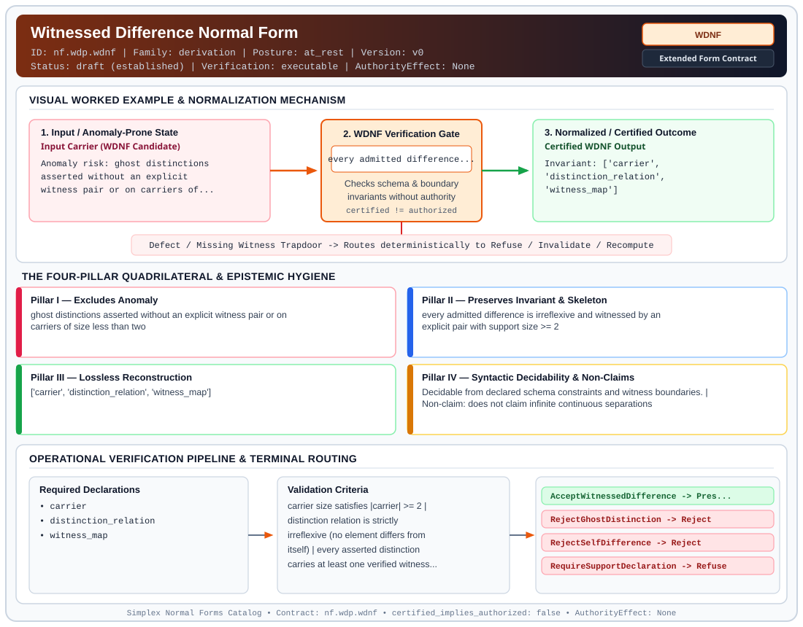

# Witnessed Difference Normal Form (`WDNF`)

> **Contract ID:** `nf.wdp.wdnf` | **Family:** `derivation` | **Index Status:** `draft` | **AuthorityEffect:** `None`

**[⬅ Back to Wiki Home](Home)** | **[View SVG Diagram](images/nf.wdp.wdnf.svg)**

---

## 1. Executive Summary & Metadata

Witnessed Difference Normal Form (WDNF) enforces structural normalization and explicit defect routing in the derivation regime.

| Property | Value |
| :--- | :--- |
| **Canonical ID** | `nf.wdp.wdnf` |
| **Short Name** | `WDNF` |
| **Full Name** | Witnessed Difference Normal Form |
| **Family** | `derivation` (MSS-N Tower Algebraic Derivation, Split Extension-Retraction & Obstruction Contracts) |
| **Qualification** | Extended Form Contract (Normal Form Contract) |
| **Data / Math Posture** | at_rest |
| **Index Status** | `draft` |
| **Theory Status** | `established` |
| **Verification Status** | `executable` |
| **Contract Version** | `v0` |
| **Governance Fence** | `AuthorityEffect: None` (`certified_implies_authorized: false`) |

---

## 2. Visual Architecture & Normalization Diagram



---

## 3. Concrete Worked Example & Mechanism

### Visual Transition Summary

| Stage | Carrier / Operator | Concrete State / Invariant |
| :--- | :--- | :--- |
| **1. Before / Candidate Input** | `Input Carrier (WDNF Candidate)` | Anomaly risk: ghost distinctions ; asserted without an explicit ; witness pair or on carriers of... |
| **2. Normalization / Gate** | `WDNF Verification Gate` | `every admitted difference...` (`certified_implies_authorized: false`) |
| **3. After / Certified Output** | `Certified WDNF Output` | Invariant: ['carrier', ; 'distinction_relation', ; 'witness_map'] |

---

## 4. The Four-Pillar Quadrilateral & Non-Claims

Every contract in `simplex-normal-forms` is evaluated against the **Four-Pillar Quadrilateral** defined in `contracts/_golden_nfs/standard.yaml`:

| Pillar | Requirement | Contract Specification for `nf.wdp.wdnf` |
| :--- | :--- | :--- |
| **Pillar I: Excludes Anomaly** | Name and eliminate a specific class of data or state defects. | ghost distinctions asserted without an explicit witness pair or on carriers of size less than two |
| **Pillar II: Preserves Invariant** | State the structural invariant and protected skeleton preserved across transitions. | **Invariant:** every admitted difference is irreflexive and witnessed by an explicit pair with support size >= 2<br>**Protected Skeleton:** ['carrier', 'distinction_relation', 'witness_map'] |
| **Pillar III: Lossless Reconstruction** | State the non-loss reconstruction operator (join, direct sum, pullback, or replay). | Lossless reconstruction under declared projection, direct sum, or pullback operators. |
| **Pillar IV: Syntactic Decidability** | State how conformance is decided from declared constraints without unbudgeted scans. | Decidable from declared schema and witness metadata within bounded evaluation budgets. |

### Explicit Non-Claims (`certified_implies_authorized: false`)

- does not claim infinite continuous separations
- does not grant execution authority

---

## 5. Operational Verification & Terminal Routing

### 5.1 Required Declarations

- carrier
- distinction_relation
- witness_map

### 5.2 Required Evidence

- carrier_size
- witness_pair_presence

### 5.3 Validation Criteria

| Criterion ID | Name | Condition |
| :--- | :--- | :--- |
| `criterion` | Check | carrier size satisfies |carrier| >= 2 |
| `criterion` | Check | distinction relation is strictly irreflexive (no element differs from itself) |
| `criterion` | Check | every asserted distinction carries at least one verified witness pair |

### 5.4 Terminal Route Map

Every evaluation terminates in a declared local route mapped to a canonical terminal in `standard.yaml`:

| Local Terminal Route | Canonical Terminal |
| :--- | :--- |
| `AcceptWitnessedDifference` | `Preserve` |
| `RejectGhostDistinction` | `Reject` |
| `RejectSelfDifference` | `Reject` |
| `RequireSupportDeclaration` | `Refuse` |

### 5.5 Declared Failure Modes

- **symptom**: distinction claimed on a singleton carrier, **diagnosis**: subsingleton distinction violation, **terminal**: RequireSupportDeclaration
- **symptom**: distinction claimed without an empirical or formal witness pair, **diagnosis**: ghost distinction, **terminal**: RejectGhostDistinction
- **symptom**: term claimed distinct from itself, **diagnosis**: irreflexivity violation, **terminal**: RejectSelfDifference

---

## 6. Epistemic Claim Hygiene Quadrant

In accordance with the repository's epistemic claim discipline:

1. **What it supports:**
   - Supports syntactic and operational checking of `nf.wdp.wdnf` (`WDNF`) against its declared schema, boundary constraints, and witness obligations in this model.
   - Supports deterministic terminal routing (`AcceptWitnessedDifference, RejectGhostDistinction, RejectSelfDifference, RequireSupportDeclaration`) when required declarations or invariants fail.
2. **What it does not support:**
   - Does not confer operational authority (`AuthorityEffect: None`, `certified_implies_authorized: false`).
   - Does not claim semantic truth of undeclared external processes or unverified upstream inputs beyond the declaredprotected skeleton.
3. **The narrowest defensible claim:**
   - Within the declared substrate `at_rest`, this contract enforces that `ghost distinctions asserted without an explicit witness pair or on carriers of size less than two` is either excluded under `every admitted difference is irreflexive and witnessed by an explicit pair with support size >= 2` or routed to an explicit refusal/recovery terminal.
4. **The next test needed:**
   - Property-based falsification and mutation testing across boundary edge cases and composed multi-step pipelines for `nf.wdp.wdnf`.

---

## 7. Canonical YAML Contract (`contracts/nf.wdp.wdnf.yaml`)

<details>
<summary><strong>Click to expand full canonical YAML contract (contracts/nf.wdp.wdnf.yaml)</strong></summary>

```yaml
schema_version: smplx.nf.contract.v0
contract_kind: form_contract
identity:
  id: nf.wdp.wdnf
  name: Witnessed Difference Normal Form
  short_name: WDNF
  version: v0
  status: draft
  family: derivation
  theory_status: established
  contract_status: draft
  verification_status: executable
classification:
  hierarchy_level: form
  subject_kind:
  - difference_claim
  - witness_pair
  - support_carrier
  data_posture: at_rest
  mathematical_posture: formal_algebraic
purpose:
  excludes_anomaly: ghost distinctions asserted without an explicit witness pair or on carriers of size less than two
  preserves_invariant: every admitted difference is irreflexive and witnessed by an explicit pair with support size >= 2
  protected_skeleton:
  - carrier
  - distinction_relation
  - witness_map
  erased_structure:
  - observation_path_transients
  non_claims:
  - does not claim infinite continuous separations
  - does not grant execution authority
declarations_required:
- carrier
- distinction_relation
- witness_map
evidence_required:
- carrier_size
- witness_pair_presence
validation_criteria:
- carrier size satisfies |carrier| >= 2
- distinction relation is strictly irreflexive (no element differs from itself)
- every asserted distinction carries at least one verified witness pair
proof_obligations:
- id: wdnf.support_size_floor
  status: upstream_theorem
  ref: 070_witnessed_difference_programme_wdp
  section: levels/level_00_admitted_cut.md
terminal_routes:
- AcceptWitnessedDifference
- RejectGhostDistinction
- RejectSelfDifference
- RequireSupportDeclaration
terminal_route_map:
  AcceptWitnessedDifference: Preserve
  RejectGhostDistinction: Reject
  RejectSelfDifference: Reject
  RequireSupportDeclaration: Refuse
certification:
  certificate_required: true
  certificate_kind: witnessed_difference_certificate
  obstruction_class_required: false
  loss_ledger_required: false
  loss_ledger_trigger_id: null
  verifier_required: true
authorization:
  authorized_by: null
  certified_implies_authorized: false
failure_modes:
- symptom: distinction claimed on a singleton carrier
  diagnosis: subsingleton distinction violation
  terminal: RequireSupportDeclaration
- symptom: distinction claimed without an empirical or formal witness pair
  diagnosis: ghost distinction
  terminal: RejectGhostDistinction
- symptom: term claimed distinct from itself
  diagnosis: irreflexivity violation
  terminal: RejectSelfDifference
definition:
  formal_statement: a difference claim is in Witnessed Difference Normal Form iff it is defined on a carrier with support size at least 2, is irreflexive, and every distinction is witnessed by an explicit non-identical pair
  quadrilateral:
    qualifies_as_true_normal_form: false
    qualification_gap: ontological_boundary_not_relational_project_join
    anomaly_exclusion: ghost distinctions, subsingleton claims, and self-difference
    lossless_join:
      status: quotient_reconstruction
      statement: quotient carrier is reconstructed modulo the indistinguishability relation
    dependency_preservation:
      status: irreflexivity_preserved
      statement: irreflexivity and witness presence are preserved locally on carrier pairs
    syntactic_decision:
      status: witness_decidable
      statement: decidable from the finite incidence matrix of witness pairs
schema_ref: ./normal_form_contract_schema.yaml
```

</details>
